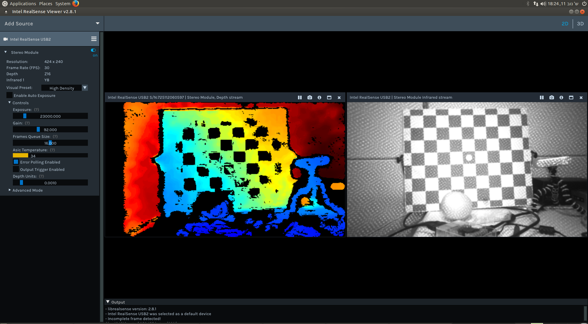

This page describes how to run RealSense D400 cameras on a Raspberry Pi by building the SDK from source with the user-space RSUSB backend. It is for anyone setting up a camera on a Raspberry Pi 3 or a similar low-memory single-board computer. The repository guides it is based on are [RaspberryPi3.md](https://github.com/realsenseai/librealsense/blob/development/doc/RaspberryPi3.md) (Raspberry Pi 3 Model B with Ubuntu MATE) and [installation_raspbian.md](https://github.com/realsenseai/librealsense/blob/development/doc/installation_raspbian.md) (Raspbian on a Raspberry Pi 3 and 3+, with a D435).

Both repository guides were written for old Raspberry Pi 3 images (the Raspbian guide shows GCC 6.3 and CMake 3.7.2). The steps below keep the parts that the current code and scripts still support; for anything else follow [[Installation Linux]].

## What to expect

The Raspberry Pi 3 Model B has only a USB 2 interface, so the guide warns that the camera's capabilities are severely reduced because of the limited bandwidth. The guide shows the [[Realsense Viewer Manual]] streaming depth at 480x270 and 30 FPS, and depth with infrared at 424x240 and 30 FPS.



## Prepare the system

1. Update the system and reboot:
   ```sh
   sudo apt update; sudo apt upgrade
   sudo reboot
   ```
2. Add swap if the board has little RAM. If the build crashes or exits with an error code, create a swap file and build again. The Raspbian guide raises `CONF_SWAPSIZE` in `/etc/dphys-swapfile` from the default 100 to `2048` (2 GB) and restarts the service:
   ```sh
   sudo /etc/init.d/dphys-swapfile restart
   ```
3. Install the build dependencies. The scripts in the repository install these packages for a source build on a small board (`scripts/libuvc_installation.sh`):
   ```sh
   sudo apt-get install git cmake libssl-dev freeglut3-dev libusb-1.0-0-dev pkg-config libgtk-3-dev unzip -y
   ```
   The Ubuntu guide (`doc/installation.md`) also recommends `libudev-dev`; with it installed the SDK detects USB devices through events instead of polling.
4. Make sure your CMake is at least 3.10, the minimum the top-level `CMakeLists.txt` asks for. The CMake 3.11.4 build in the Raspbian guide is only needed on images that ship an older CMake.

## Install the udev rules

Clone the repository and copy the rules file for the libusb based backend:

```sh
cd ~
git clone https://github.com/realsenseai/librealsense.git
cd librealsense
sudo cp config/99-realsense-libusb.rules /etc/udev/rules.d/
sudo udevadm control --reload-rules && sudo udevadm trigger
```

`scripts/libuvc_installation.sh` also copies `config/99-realsense-d4xx-mipi-dfu.rules`.

## Build the SDK

The Raspbian guide builds with the RSUSB backend, so no kernel patching is needed:

```sh
cd ~/librealsense
mkdir build && cd build
cmake .. -DBUILD_EXAMPLES=true -DCMAKE_BUILD_TYPE=Release -DFORCE_RSUSB_BACKEND=ON
make -j1
sudo make install
```

The guide itself uses `-DFORCE_LIBUVC=true`, which `CMake/lrs_options.cmake` marks as deprecated in favour of `FORCE_RSUSB_BACKEND`. `make -j1` keeps memory use low on a small board. If the loader cannot find the installed library, add `/usr/local/lib` to `LD_LIBRARY_PATH`, as the guide does in the shell profile.

### Optional: Python bindings

From the same build folder, enable the bindings and rebuild:

```sh
cmake .. -DBUILD_PYTHON_BINDINGS=bool:true -DPYTHON_EXECUTABLE=$(which python3)
make -j1
sudo make install
```

`BUILD_PYTHON_BINDINGS` defaults to `OFF`. The module is installed under `/usr/local/lib` in the guide, so add that folder to `PYTHONPATH`. See [[Python Wrapper]] for the wrapper itself.

## Enable the OpenGL driver

The RealSense Viewer needs OpenGL. Both guides activate the OpenGL driver on the Pi: the Raspbian guide does it with `sudo raspi-config`, under "7 Advanced Options", "A7 GL Driver", "G2 GL (Fake KMS)", and then reboots. Menu names can differ on newer images.

## Try the camera

Connect the camera and run:

```sh
realsense-viewer
```

You can also try the [examples](https://github.com/realsenseai/librealsense/tree/development/examples) and [tools](https://github.com/realsenseai/librealsense/tree/development/tools); see [[Code Samples]] and [[Command Line Tools]].

## See also

- [[Installation Linux]]
- [[Build Configuration]]
- [[Supported Devices]]

<!-- wikigen:footer -->
_Maintained from librealsense `development`; last checked at commit [`5c14a0b`](https://github.com/realsenseai/librealsense/commit/5c14a0b5309a878032e7196889df475adf8c4f7d)._
<!-- /wikigen:footer -->
